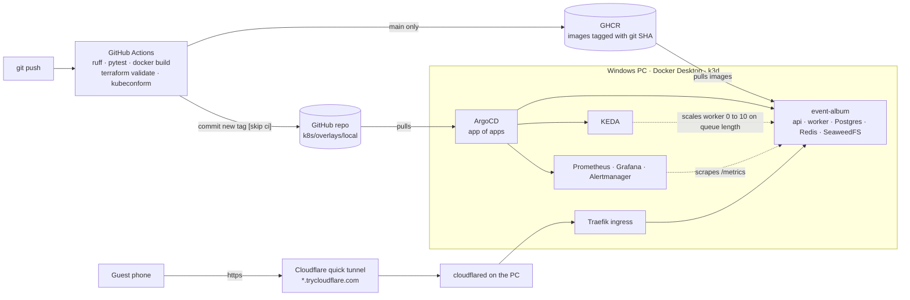

# Event Album

[](https://github.com/Itay-nomis/event-album/actions/workflows/ci.yml)

Live photo album for events. Guests scan a QR code, upload photos from their phone (no app install),
and the photos appear on the venue screen in real time.

This is a hands-on DevOps learning project: the app is the workload, the platform around it is the point -
containers, CI/CD, Kubernetes, GitOps, event-driven autoscaling, observability and infrastructure as code.
**Everything in the default path is free**: a local Kubernetes cluster on a Windows PC, a free Cloudflare
quick tunnel for a public HTTPS link, GitHub Actions and GitHub Container Registry.

> Hebrew step-by-step guide for Windows: [docs/GUIDE.he.md](docs/GUIDE.he.md)

## Architecture

### The app

```
 Guest phone ──upload──► API (FastAPI) ──original──► Object storage (S3 / Azure Blob)
                           │    │
                           │    └──job──► Redis list "jobs" ──► Worker (resize, blur filter)
                           │                                        │
                           ▼                                        ▼
                       Postgres ◄─────────── status ────────── publish "new photo"
                                                                    │
 Venue screen ◄────── live updates (SSE) ◄──── Redis pub/sub ◄──────┘
```

| Service    | Role                                                                    |
|------------|-------------------------------------------------------------------------|
| `api`      | Pages, uploads, event data, live stream (SSE), media proxy, QR codes    |
| `worker`   | Background image processing: EXIF rotate, resize, blur detection        |
| `postgres` | Events and photo metadata                                               |
| `redis`    | Job queue + pub/sub for live updates                                    |
| `storage`  | SeaweedFS (S3-compatible) locally; Azure Blob Storage in the cloud      |

### The platform



## Stack

| Area | Tool | Why |
|---|---|---|
| App | Python 3.12, FastAPI, Pillow, psycopg, redis-py | small, readable services |
| Containers | Docker, Docker Compose | the same images everywhere; non-root, pinned base images |
| CI | GitHub Actions (actions pinned to SHAs), ruff, pytest | free for public repos, fast feedback |
| Registry | GitHub Container Registry (`ghcr.io/itay-nomis/event-album-*`) | free, uses the built-in `GITHUB_TOKEN` |
| Kubernetes | k3d (k3s in Docker) + Kustomize base/overlays | a real cluster on a laptop, no cloud bill |
| Ingress | Traefik (bundled with k3s) | ingress-nginx is retired |
| GitOps | ArgoCD, app-of-apps | git is the source of truth; drift is healed automatically |
| Autoscaling | KEDA (worker, Redis list length, scale to zero) + HPA (api, CPU) | event-driven scaling |
| Observability | kube-prometheus-stack: Prometheus, Grafana, Alertmanager | metrics, dashboard, alerts |
| Public access | Cloudflare quick tunnel (`cloudflared`, no account) | free HTTPS link for phones |
| Load testing | k6 (`grafana/k6` image) | simulate a 300-guest wedding |
| IaC | Terraform + azurerm (AKS, Blob, Postgres Flexible, workload identity, budget) | written and validated, applied only by hand |

## Repository layout

```
api/                FastAPI service (+ tests)        worker/        image worker (+ tests)
k8s/base/           app manifests (Deployments, Service, HPA, KEDA ScaledObject, Ingress)
k8s/components/     redis, monitoring (ServiceMonitor, PodMonitor, alerts, Grafana dashboard)
k8s/overlays/local  k3d: + Postgres, SeaweedFS          k8s/overlays/azure   AKS: Blob + Azure Postgres
argocd/             root app + child apps (event-album, KEDA, kube-prometheus-stack)
.github/workflows/  CI/CD                                infra/azure/   Terraform (never auto-applied)
scripts/            local-up.ps1, tunnel.ps1, local-down.ps1, validate-k8s.sh
loadtest/           k6 wedding simulation                docs/          Hebrew guide
```

## Run it

### 1. Docker Compose (quickest)

```powershell
copy .env.example .env
docker compose up --build
```

App: <http://localhost:8000> · worker metrics: <http://localhost:9100/metrics>.
Public link for phones: `.\scripts\tunnel.ps1 -Port 8000`, then open the printed `https://…trycloudflare.com`
address **on the PC** to create the event, so the QR code points at the public address.

### 2. Local Kubernetes with GitOps

Prerequisites (PowerShell): `winget install --id Docker.DockerDesktop -e`, `k3d.k3d`, `Kubernetes.kubectl`,
`Cloudflare.cloudflared` (the script checks and prints these hints).

ArgoCD deploys **what is on `main` on GitHub**, so the manifests must be merged to `main` first.

```powershell
# First run, before CI has pushed any image to GHCR: build the images locally and import them
.\scripts\local-up.ps1 -LocalImages

# Later runs (CI publishes images on every push to main):
.\scripts\local-up.ps1
```

The script creates a k3d cluster (host `8080` → Traefik), creates the secrets (never in git), installs ArgoCD,
applies `argocd/root-app.yaml` and prints the URLs and passwords. ArgoCD then installs KEDA,
kube-prometheus-stack and the app.

| What | How |
|---|---|
| App | <http://localhost:8080> |
| Public HTTPS link | `.\scripts\tunnel.ps1` |
| ArgoCD | `kubectl -n argocd port-forward svc/argocd-server 8081:443` → <https://localhost:8081> (user `admin`) |
| Grafana | `kubectl -n monitoring port-forward svc/kube-prometheus-stack-grafana 3000:80` → <http://localhost:3000> |
| Prometheus | `kubectl -n monitoring port-forward svc/kube-prometheus-stack-prometheus 9090:9090` |
| Tear down | `.\scripts\local-down.ps1` |

**Private repo?** Create a fine-grained GitHub token with read-only *Contents* access to this repo and run
`.\scripts\local-up.ps1 -GitHubToken <token>`; it is stored as an ArgoCD repository Secret. A public repo needs nothing.

**GHCR images are private by default.** After the first CI run on `main`, make both packages
(`event-album-api`, `event-album-worker`) public in GitHub → Packages → Package settings, or the cluster cannot pull them.

### 3. CI/CD flow

1. Every PR and push: ruff, pytest, Docker build of both images, `terraform fmt -check` + `validate`,
   `kustomize build` + `kubeconform` of every overlay.
2. Push to `main` only: images are pushed to GHCR tagged with the git SHA, then a bot commit
   (`[skip ci]`) writes that tag into `k8s/overlays/local/kustomization.yaml`.
3. ArgoCD notices the commit and rolls out the new images. Rollback = `git revert` that commit.

### 4. Load test

```powershell
.\loadtest\run-loadtest.ps1                 # 300 guests, ~900 photos in 10 minutes
.\loadtest\run-loadtest.ps1 -TimeScale 0.1  # 1-minute smoke test
```

Watch `kubectl -n event-album get pods -w` and the Grafana dashboard **Event Album**: KEDA scales the worker
from 0 up to 10 replicas as the queue grows, then back to 0. See [loadtest/README.md](loadtest/README.md).

### 5. Azure (later, costs money)

[infra/azure](infra/azure/README.md) holds Terraform for AKS (free tier, 1 node, workload identity, KEDA add-on),
Blob Storage, Postgres Flexible Server (B1ms) and a budget alert. CI only validates it; apply it by hand with the
free trial credit and `terraform destroy` right after.

## Configuration

| Variable | Used by | Meaning |
|---|---|---|
| `DATABASE_URL` | api, worker | Postgres connection string (Secret) |
| `REDIS_URL` | api, worker | queue + pub/sub |
| `STORAGE_BACKEND` | api, worker | `s3` (SeaweedFS/S3) or `azure` (Blob, `DefaultAzureCredential`) |
| `S3_ENDPOINT`, `S3_BUCKET`, `S3_ACCESS_KEY`, `S3_SECRET_KEY` | api, worker | S3 backend |
| `AZURE_STORAGE_ACCOUNT_URL`, `AZURE_STORAGE_CONTAINER` | api, worker | Azure backend (workload identity, no keys) |
| `PUBLIC_BASE_URL` | api | optional public URL for QR codes; otherwise taken from `X-Forwarded-*` / `CF-Visitor` / the request |
| `BLUR_THRESHOLD` | worker | edge-variance score below which a photo is hidden as blurry (default 60) |
| `METRICS_PORT` | worker | Prometheus port (default 9100) |

Operational endpoints: `GET /healthz` (liveness), `GET /readyz` (Postgres + Redis), `GET /metrics` (api);
worker metrics on `:9100/metrics`.

**Secrets** are never committed: Compose reads the gitignored `.env`; in Kubernetes `scripts/local-up.ps1`
creates the `event-album-secrets` Secret (random Postgres password, or the values in the gitignored
`k8s/overlays/local/secrets.env` - see `secrets.env.example`) and the Grafana admin Secret.

## Development

```powershell
pip install -r api/requirements.txt -r worker/requirements.txt -r requirements-dev.txt
ruff check . ; ruff format --check . ; pytest
bash scripts/validate-k8s.sh        # needs kustomize + kubeconform
```

## Roadmap

- [x] **1. Local** - app runs with Docker Compose
- [x] **2. CI** - GitHub Actions: lint, test, build, push images to GHCR
- [x] **3. Kubernetes** - Kustomize base + overlays, probes, resources, non-root, HPA
- [x] **4. GitOps** - ArgoCD app of apps; CI commits the image tag, ArgoCD deploys it
- [x] **5. Scale** - KEDA scales workers on queue length (0..10); k6 load test of a 300-guest wedding
- [x] **6. Observability** - Prometheus metrics, Grafana dashboard, alert rules
- [x] **7. Cloud as code** - Terraform for AKS, Blob, Postgres, workload identity, budget (validated in CI)
- [ ] **8. Cloud for real** - apply on the Azure free trial, deploy the azure overlay, destroy
- [ ] **9. Hardening** - reliable queue (`BLMOVE` + retry), Sealed Secrets / External Secrets, TLS on a real domain, alert routing to Slack/Telegram
- [ ] **10. Bonus** - AI photo curation, incident-analysis bot
